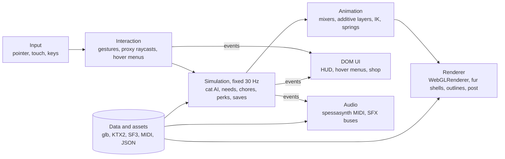
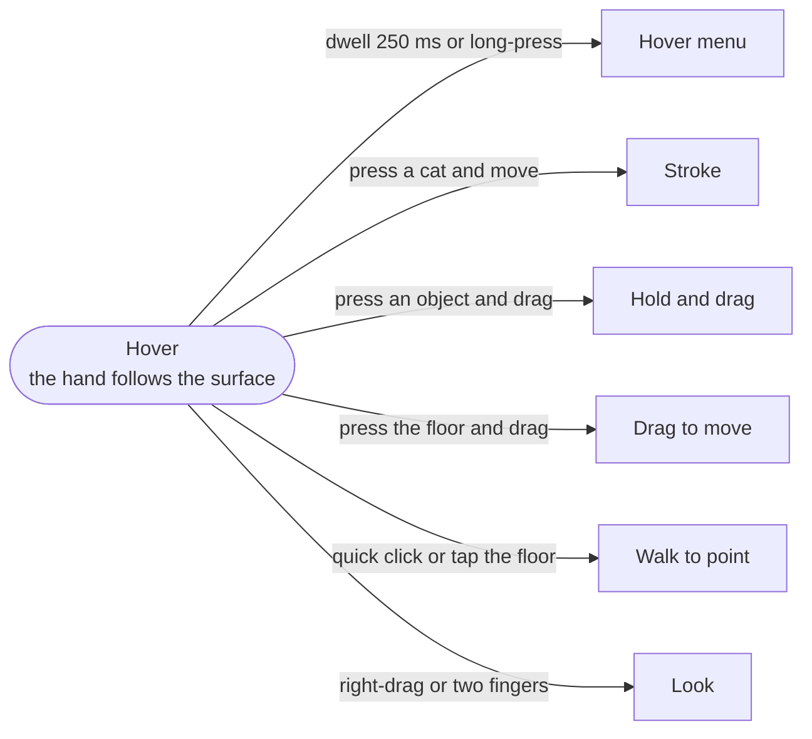

# Tuxedo Cafe

**A cozy first-person cat café for the browser.** Pet, play with and slowly win over cats who live their own lives.

You are a patron you name yourself. You never see yourself: your hand is your cursor. The cats eat, nap, groom, squabble and wander on their own schedules, and some of them will never love you as much as you love them. Chores around the café earn **C$ ("cat bucks")** for perks: a cappuccino, catnip, a laser pointer, a feather wand, or a harness walk on the sidewalk outside.

> **Status:** pre-production
>
> **Playtest build:** <https://creditunionfruitfly.github.io/tuxedocafe/> (latest `main`, live from M0 onward)
>
> **Repository:** <https://github.com/creditunionfruitfly/tuxedocafe>
>
> **Engine:** a small TypeScript engine on three.js `WebGLRenderer` (WebGL 2)
>
> **Platforms:** desktop browsers (mouse, WASD) and phones and tablets in landscape (touch)
>
> **Look:** Nintendogs-era techniques at modern fidelity; Frutiger Aero UI
>
> **Score:** soft jazz and Wii-Shop-era MIDI, played live from MIDI files
>
> **Built with:** OpenAI Codex on ChatGPT Pro, across two weekly usage allowances

## Contents

- [The game](#the-game)
- [Platforms and tiers](#platforms-and-tiers)
- [Technical decisions](#technical-decisions)
- [Architecture](#architecture)
- [Cats: behavior spec](#cats-behavior-spec)
- [Hand and controls spec](#hand-and-controls-spec)
- [Chores, C$ and perks](#chores-c-and-perks)
- [Rendering spec](#rendering-spec)
- [Animation spec](#animation-spec)
- [Audio and music spec](#audio-and-music-spec)
- [UI spec](#ui-spec)
- [Asset pipeline spec](#asset-pipeline-spec)
- [Performance budgets](#performance-budgets)
- [Repository layout](#repository-layout)
- [Getting started](#getting-started)
- [Playtest builds and CI/CD](#playtest-builds-and-cicd)
- [Milestones and Codex budget](#milestones-and-codex-budget)
- [Working with agents](#working-with-agents)
- [References](#references)
- [Legal](#legal)

## The game

**First visit.** Pick a name and pronouns (they appear only in café text; gender has no effect on gameplay), choose your hand's skin tone and sleeve, and walk in.

**Core loop.**

1. Watch the room: who is napping in the sunbeam, who is eyeing the food bowl, who just ran up the cat tree.
2. Approach, hover over a cat and choose an action, or simply stroke it. Read its tail, ears and pupils as you go.
3. Do chores as they come up (water, food, litter) to earn C$.
4. Spend C$ on perks that open new ways to play and bond.
5. Bonds grow toward each cat's hidden ceiling. Some cats end up on your lap; some never will.
6. Leave whenever you like. The café, your C$ and every bond are saved.

There is no failure state. Ignored chores are done by café staff, and the cats are always fed.

**Pillars.**

- **Real cats first:** behavior, body language and touch preferences drawn from cat-welfare research, not cartoon logic.
- **Touch that matters:** where, how fast and how long you stroke changes how a cat responds.
- **Cozy and readable:** soft light, soft fur, soft jazz, and a UI that stays out of the way.
- **Runs everywhere:** a laptop browser or a phone held sideways.

**Resident cats** (seed roster; tune freely in `data/cats.json`).

| Cat | Coat | Age | Personality | Catnip | Harness walks |
| --- | --- | --- | --- | --- | --- |
| Mochi | Tuxedo | Adult | Cheeky, social, the café mascot | Yes | Yes, once bonded |
| Waffles | Tuxedo, chunky | Adult | Gentle lap lover, slow mover | Yes | Yes, once bonded |
| Pepper | Brown mackerel tabby | Adult | Shy, prefers high perches | Yes | No |
| Biscuit | Orange | Adult | Food-driven, follows the kibble bag | Yes | Yes, once bonded |
| Clementine | Calico | Kitten | Bossy for her size, climbs everything | No (too young) | No (too young) |
| Juniper | Brown rosetted Bengal | Adult | Playful, athletic and chatty; paddles in the water bowl | No | Yes, once bonded |
| Pixel | Glossy black Bombay | Adult | Affectionate shadow and homebody; follows you around the café | Yes | No |
| Duchess | Cream long-hair | Senior | Dignified, naps 20 hours a day | Yes | No |

Each cat also carries hidden values for sociability, playfulness, boldness, touch sensitivity, chattiness, liked and disliked petting zones, and a **maximum affinity** for the player, plus a `voicePitch` for the shared cat sounds.

## Platforms and tiers

| Setting | Desktop high | Desktop default | Phone | Low phone |
| --- | --- | --- | --- | --- |
| Render scale | 100% | Dynamic, 85–100% | Dynamic, 70–90% | 60–75% |
| MSAA | 4× | 4× | Off | Off |
| Fur shells on near cats | 24 | 16 | 8 | 4 |
| Near-cat LOD | 30k triangles | 30k | 12k | 12k |
| Shadows | Shadow-mapped key light plus contact decals | Same | Contact decals | Contact decals |
| Frame target | 60 fps or higher | 60 fps | 60 fps | 30 fps |
| MIDI polyphony | 64 voices | 64 | 32 | 24 |
| UI glass blur | On | On | On | Off |

- **Tier choice at boot:** probe WebGL 2, MSAA support, `deviceMemory` (Chromium only) and `hardwareConcurrency`, then run a 2-second benchmark scene and pick the highest tier that holds its frame target. Dynamic resolution keeps it there. Players can override the tier in Settings.
- **Phones must be landscape.** After the first tap, request fullscreen and call `screen.orientation.lock('landscape')` where supported. Safari supports locking only on mobile, only in fullscreen, and not during iPad multitasking, so every platform also pauses and shows a "rotate your device" overlay in portrait.
- WebGL 2 is required. Browsers without it get a friendly "unsupported" page.

## Technical decisions

Each decision was selected from the research knowledge sheet (Nintendogs techniques translated to three.js). Changing one needs an ADR in `docs/decisions/`.

| # | Area | Decision | Why |
| --- | --- | --- | --- |
| D1 | Renderer | three.js `WebGLRenderer` (WebGL 2), pinned to a current release (r186 or later) | The three.js manual still calls `WebGPURenderer` experimental and says it cannot run `ShaderMaterial` or `onBeforeCompile` GLSL, which fur shells, the toon ramp and outlines need |
| D2 | Future renderer | New materials written in TSL where practical (TSL runs on `WebGLRenderer` through a compatibility layer since r184) | Keeps a later move to `WebGPURenderer` cheap |
| D3 | Language and build | TypeScript (strict), Vite, plain DOM for UI | Small, fast, few dependencies |
| D4 | Loop | Simulation at a fixed 30 Hz with interpolation; rendering at the display rate | Reproducible cat AI and economy; smooth motion |
| D5 | Cat rig | One shared skeleton of about 60–70 bones; three mesh LODs (30k, 12k, 4k triangles), dense at the face, ears, eyes and paws | Nintendogs' budgeting rule: detail where the eye goes |
| D6 | Animation | `AnimationMixer` with additive layers, analytic two-bone leg IK, `CCDIKSolver` for spine and neck, spring-chain tails | Paws plant on any surface; heads track the hand; tails react |
| D7 | Fur | Instanced shell fur (24, 16, 8 or 4 shells) plus alpha-card tufts; alpha test with `alphaToCoverage` under MSAA | Soft, volumetric fur, Nintendogs' fluff at modern fidelity |
| D8 | Shading | Soft wrap-diffuse ramp, rim light, inverted-hull outlines that double as the hover highlight | Nintendogs' soft toon read without the low-poly look |
| D9 | Lighting | Baked lightmaps in the café; one key light plus spherical-harmonic probes for cats, hand and props; contact-shadow decals | Gentle, cheap, stable on phones |
| D10 | Outdoor scene | CC0 HDRI as background and PMREM environment; low-poly sidewalk; painted parallax backdrop | Skybox and envmap with a small download |
| D11 | Cat AI | Needs plus a utility scorer that picks goals, small behavior trees that carry them out, a hidden affinity cap and an overstimulation meter | Independent cats who choose their own business |
| D12 | Interaction | The hand rides the surface under the pointer; rays test bone-attached capsules per body region; DOM hover menus; hold-and-drag chores | Cheap, precise, and the region drives the cat's reaction |
| D13 | Input | Pointer Events for mouse and touch, WASD on desktop, drag-to-move, walk-to-point, right-drag or two-finger look, long-press as hover on touch | One input model for every device |
| D14 | Economy | Chores pay C$1–3; perks cost C$5–20 per use; all numbers in one data file | Balance without code changes |
| D15 | Music | MIDI cues played live by spessasynth_lib through a custom SF3 SoundFont; Opus renders of each cue as a fallback | Tiny downloads, live arrangement changes, the Wii-era sound |
| D16 | Assets | glTF (`.glb`) with KTX2 (Basis) textures and meshopt compression | Small downloads, GPU-native textures |
| D17 | Saves | IndexedDB with a localStorage fallback, all calls in try/catch | Private browsing can block storage |
| D18 | Physics | No general physics engine: ray–capsule tests and position-based ropes for the leash and wand | Small and predictable |
| D19 | Hosting | GitHub Pages at `creditunionfruitfly.github.io/tuxedocafe`, deployed by GitHub Actions on every merge to `main`, with frozen milestone snapshots | Always-live playtest builds from M0 onward; Pages can't set custom headers, and the game needs none. See [Playtest builds and CI/CD](#playtest-builds-and-cicd) |
| D20 | Build process | Codex on Pro, routed by task to the cheapest capable model, against a two-week allowance plan | See [Milestones and Codex budget](#milestones-and-codex-budget) |

## Architecture



- The DOM UI and audio never touch the 3D scene; they react to events (`cat:purr`, `chore:done`, `perk:start` and so on).
- Systems talk through a typed event bus and plain data components. There is no general-purpose ECS framework.
- The café scene is always loaded. The sidewalk scene loads on demand and is prefetched once the player holds C$15.

## Cats: behavior spec

**Needs** (0–1, higher is more urgent): hunger, thirst, energy, play, social, litter and grooming. They rise over time and fall when met. Adult cats sleep about 15 hours a day and are most active at dusk and dawn, so energy dominates scoring and activity peaks at the café's "golden hour".

**Affinity** grows toward a hidden cap:

```text
dA/dt = k * q * (Amax - A)
```

`A` is the current bond, `Amax` the hidden cap (0.2–1.0, seeded per cat), `q` the interaction quality and `k` a tuning rate. Bonds climb fast, then plateau. Each cat starts at 10–30% of its cap. Losses are small and never push below zero. The UI never shows numbers: bond shows as approach distance, tail-up greetings, head bunts, lap visits and returned slow blinks, plus words in the journal ("curious", "fond", "devoted").

**Overstimulation.** Each second of stroking raises a meter by base rate × touch sensitivity × zone factor (liked 0.5, neutral 1, disliked 3); it drains when the hand leaves.

| Meter | The cat shows | Outcome |
| --- | --- | --- |
| Below 0.6 | Purring, leaning in, slow blinks | Bond grows |
| 0.6 to 1.0 | Tail lashing, ears turning back, skin twitching, pupils widening | Stop now: no penalty, plus a small trust bonus |
| 1.0 or more | Swat or walk away | Bond drops; the cat avoids the hand for a while |

By default cats like the cheeks, chin and the space between the ears, and dislike the base of the tail; the belly is a trap for most cats.

**Goals.** Rest, eat, drink, use the litter box, groom, explore, watch the window, play alone, seek the player, avoid the player, socialize with another cat, knead, scratch, dusk zoomies, and respond to a perk. A utility scorer re-thinks every 0.5–2 s, staggered across cats, with inertia and seeded noise. Perk responses override everything except a full overstimulation meter.

**Space.**

- A navmesh covers the floor; jump links connect chairs, the cat tree, shelves and the window sill. Each perch has a slot count.
- When the café is busy, cats prefer higher perches.
- A cat-only room is a retreat the hand cannot enter.
- A pair matrix marks each pair of cats friendly, neutral or tense: friends groom and nap together, tense pairs keep their distance and sometimes hiss.
- Per-cat seeded randomness makes every bug report replayable.

## Hand and controls spec



Every gesture starts from Hover, and releasing (or finishing the action) returns to it.

| Gesture | Mouse and keyboard | Touch |
| --- | --- | --- |
| Hover menu | Rest the pointer on a cat or object for 250 ms; keys 1–4 pick actions | Long-press |
| Stroke | Press on a cat and move | One finger on a cat |
| Hold and drag | Press on an object and drag | Press, hold and drag |
| Move | Drag on the floor, or WASD | Drag on the floor |
| Walk to a spot | Quick click on the floor | Tap the floor |
| Look | Right-drag | Two-finger drag |
| Lean in or out | Scroll wheel | Pinch |

- **The hand:** a rigged mesh in the chosen skin tone and sleeve, parented to the camera. IK places the palm on the hit point along the surface normal, with a small offset toward the camera so it never sinks into fur. Poses: open, stroke, grab, point (laser), cup (coffee), wand (feather), leash grip.
- **Hit testing:** rays test capsules attached to bones for each body region (head, cheeks, chin, back, flank, belly, tail base, tail, paws) and boxes for bowls, the scoop, litter boxes and perch tops. A hit returns region, point and normal.
- **Stroking:** with the grain scores higher than against it; stroke speed feeds the overstimulation meter.
- **Hover menu actions:** pet, play, slow blink and call for cats; fill, clean, pick up and place for objects.
- **Accessibility:** a toggle mode replaces holding, hold time is adjustable, a left-handed layout mirrors the HUD, sound captions describe purrs and meows, and a reduced-motion setting calms camera moves.
- **Touch hygiene:** `touch-action: none` on the canvas, pointer capture for drags, safe-area insets respected, and the game pauses on `visibilitychange`.

## Chores, C$ and perks

With these numbers a diligent player earns about C$86 an hour and spends roughly a quarter of play time on chores (from a 2,000-run simulation of these rules).

| Chore | Pays | Available about every | Gesture |
| --- | --- | --- | --- |
| Fill water bowl | C$1 | 3 minutes | Hold the bowl under the tap for 3 s, carry it back |
| Fill food bowl | C$2 | 4 minutes | Tilt the kibble bag and pour to the line |
| Clean litter box | C$3 | 5 minutes | Drag the scoop through, tip clumps into the bin, rake level |

- A station glows when food or water drops below a quarter, or when a litter box crosses its dirt threshold. The player has 2 minutes; then café staff do it.
- A cat that watches you fill its bowl gains a little bond and often comes to eat. Dirty litter raises every cat's stress, and cats avoid a dirty box.

| Perk | Cost | What happens | Rules | Median time to afford from zero |
| --- | --- | --- | --- | --- |
| Coffee | C$5 | Sit at a table and drink a cappuccino in first person, with sips and latte art | About 3 minutes or until you stand; cats with a high bond may hop onto your lap | 3.8 min |
| Catnip | C$8 | Place a bag; responders sniff, lick, roll, rub and zoom | Only catnip responders react; about 10 minutes of effect, then that cat ignores catnip for the rest of the visit | 5.9 min |
| Laser pointer | C$10 | Aim a dot for 2 minutes while cats stalk, wiggle and pounce | The dot never lands on a cat's head, and the session ends on a toy mouse the cats can catch | 7.4 min |
| Feather toy | C$15 | Steer a wand toy with rope physics; cats bat, leap and catch | About 3 minutes, ending with a catch | 10.7 min |
| Harness | C$20 | Fit a harness and walk a cat on the sidewalk outside | Only cats with enough bond and boldness agree; on the walk a cat may freeze, flop, sniff or explore; head back in any time | 14.4 min |

Perks are bought per use from the counter. If a perk needs a willing cat and none qualifies, the menu says so before charging. All prices, payouts and timings live in `data/economy.json`; there are no real-money purchases.

## Rendering spec

- **Fur shells:** N instanced copies of the skinned mesh pushed out along normals by `length × i / N`, in one draw that includes three.js skinning chunks and reads the shell index from `gl_InstanceID`. A tiling strand-noise texture, an alpha threshold that rises with i, darker roots, lighter tips, a flow map for combing, and gravity and velocity shear in the vertex shader. Draw shells inside-out with depth writes on so early depth tests reject hidden fragments.
- **Fur cards:** alpha-card tufts at the ears, cheek ruff, chest and tail tip.
- **Coats:** one RGBA mask per cat (R white spotting, G tabby markings such as stripes or Juniper's rosettes, B orange/black split for calicos and torties, A fur length) plus palette uniforms. Paint stripes along the body's flow; avoid straight high-contrast lines. Juniper's Bengal coat adds a glitter sparkle to the sheen; Pixel's short Bombay coat uses short shells and a stronger sheen.
- **Eyes:** a separate mesh with a cornea dome, iris parallax and a sharp highlight; pupil size driven by light level and emotion; eye shine outdoors at dusk.
- **Shading:** soft wrap-diffuse ramp and rim light via `onBeforeCompile` on `MeshStandardMaterial`; ear thickness maps so backlit ears glow; a Kajiya–Kay-style sheen along the fur flow on desktop.
- **Outlines:** inverted hull with a constant pixel width, tinted from the fur color; hover swaps it to the UI accent color.
- **Café lighting:** Blender-baked lightmaps on the second UV set; one directional key light (shadowed on desktop) and spherical-harmonic probes for dynamic objects; animated sunbeam patches that cats seek for naps; a warm grading LUT, gentle bloom and a vignette.
- **Contact shadows:** a soft decal under each cat driven by paw and body bones, on every tier.
- **Sidewalk:** an HDR panorama as `scene.background`, prefiltered with `PMREMGenerator` into `scene.environment`; about 40 m of sidewalk, low-poly storefronts, alpha-card trees, parked cars and a painted parallax backdrop; a sun aligned with the HDRI.

## Animation spec

- **Skeleton:** root, pelvis, 5 spine joints, 2 neck joints, head, jaw, 2 joints per ear, eyes, scapula-to-toe front legs, thigh-to-toe hind legs, and a 10–14-joint tail, about 60–70 bones in all. Face blendshapes cover mouth open, nose wrinkle, cheek puff, whiskers and flattened ears. Four weights per vertex.
- **Stack, in order each frame:** locomotion blend (idle, walk, trot, gallop, plus turn, start and stop clips), full-body actions, additive emotional layers (tail, ears, purr breathing, blinks), look-at, leg IK, then secondary springs (tail, ears, fur lag).
- **Gait thresholds:** walk below about 1.1 m/s, trot to about 2.2 m/s, gallop above, from measured cat gait speeds.
- **First-playable clip list (about 40):** idle, walk, trot, gallop, turn left and right, start, stop, sit down, sit idle, loaf, lie on side, sprawl, curl-up sleep, wake and stretch, yawn, groom face, groom flank, eat crouch, drink lapping, paw at water, litter dig, litter squat, litter cover, knead, scratch post, jump up low and high, jump down low and high, land, pounce, bat left and right, head rub, tail-up greeting, slow blink, hiss, flinch and startle, swat, walk away offended, roll over.
- **Perk clips (about 15):** catnip sniff, lick, roll and zoom; stalk crouch, butt wiggle, pounce on a dot, catch toy; feather bat, leap and catch; harness freeze, low walk, flop and sniff.
- **IK:** analytic two-bone IK per leg plants paws and adjusts pelvis height, and front-paw reaches aim at predicted toy positions. `CCDIKSolver` handles the spine and neck with per-link limits. IK runs after the mixer and before rendering; distant cats update animation and IK at a reduced rate.
- **Leash:** a position-based rope of about 20 segments from the hand to the harness ring. Above a tension threshold it nudges the cat's navigation goal; it never yanks.
- **Authoring:** keyframed in Blender at 30 fps from filmed reference (with owners' permission). Locomotion is in place with `extras.authoredSpeed`; jumps keep root motion. All cats share the skeleton; kittens, adults and chunky cats differ by bone scales and blendshapes.

## Audio and music spec

- **Direction:** soft lounge jazz (bossa nova and cool-jazz feels, about 80–110 BPM) with Frutiger Aero gloss: electric piano, vibraphone, nylon guitar, upright bass, brushed drums, flute or muted trumpet, marimba and glockenspiel, plus water and birdsong textures. The Wii Shop era is a reference for mood only: no borrowed melodies, no recognizable progressions, no names in prompts.
- **Cues:** café day (3–4 variants), coffee break, laser and feather play, catnip, sidewalk walk, and short jingles for menus, purchases, chores and bond-ups. Each cue lists its live changes in `audio/cues.json` (channels that fade in, tempo nudges, program swaps).
- **MIDI rules:** Standard MIDI File type 1, at most 16 channels, only programs that exist in the game's bank, loop start and end markers, peak polyphony within the tier caps (64 desktop, 32 phone, 24 low phone).
- **Runtime:** spessasynth_lib (Apache-2.0) plays MIDI through the SF3 bank in the browser. The `AudioContext` starts on the first user gesture; music and SFX run on separate buses; music ducks a little under purrs.
- **SoundFont:** a custom compact SF3 bank with only the instruments the score uses, at most 12 MB. MuseScore General (MIT) is the development fallback. Every sample's license goes in the provenance log.
- **Fallback renders:** CI renders every cue with spessasynth_core in Node to an Opus loop (plus an AAC copy for older Safari), for devices where the live synth struggles.
- **SFX:** every cat sound (purrs, meows, trills, hisses, eating, drinking, litter, paws) is supplied by the project owner, made with ElevenLabs; see [Cat sounds from ElevenLabs](#cat-sounds-from-elevenlabs). The Composer makes the rest: kibble pouring, the tap, the litter scoop, toy bells, the espresso machine, café murmur, rain on glass and distant street sound. On Android, `navigator.vibrate` can pulse with the purr while you stroke, as an optional extra.

### Cat sounds from ElevenLabs

The project owner makes every cat sound with [ElevenLabs Sound Effects](https://elevenlabs.io/docs/eleven-creative/playground/sound-effects) and drops the downloads into `audio/sfx/cat/src/` under the names below. The Composer prepares them for the game; agents never generate, replace or re-synthesize them.

**Making them (owner).** ElevenLabs settings as of October 2026:

1. Use a paid plan. ElevenLabs says free-plan output has no commercial license and must credit ElevenLabs ([help page](https://elevenlabs.io/docs/help-center/legal/can-i-publish-the-content-i-generate-on-the-platform)).
2. Paste a prompt and set its duration from the table. Turn on **Looping** only for names ending in `_loop`.
3. Start with **Prompt influence** at its 30% default. If takes drift (music, voices, the wrong animal), raise it toward 80%; if all four takes sound alike, lower it.
4. Each generation returns four takes. Keep as many as the Takes column says, named `_01`, `_02` and `_03`. For a cat's own voice, keep takes that sound like the same animal.
5. Download one-shots as WAV (48 kHz). ElevenLabs offers looping effects as MP3 only, so loops arrive as `.mp3`. If a loop's seam is audible, generate the same prompt without Looping, download it as WAV under the same `_loop` name, and the Composer will cut the loop.
6. Every prompt follows one pattern: the recording style, the source and its action, then what you should hear. If you write your own, describe sounds literally. Avoid "no music" or "no noise" (naming a sound can invite it) and comparisons such as "like a motor". Skip breed names the model could misread: "Bengal" can drift toward a tiger. Never name real cats, people, films or games.

**Names:** `sfx_cat_[<cat>_]<sound>[_<detail>][_loop]_<nn>.<wav|mp3>`, lowercase with underscores. `<cat>` is the cat's id in `data/cats.json` and marks that cat's own voice; `<nn>` is the take number. The tables show take `_01`.

**Core set** (needed by M2)

| File | Seconds | Takes | Prompt |
| --- | --- | --- | --- |
| `sfx_cat_purr_soft_loop_01.mp3` | 10 | 1 | Close-mic recording of a relaxed house cat purring softly: a slow, steady, low rumble that rises and falls with each breath, isolated. |
| `sfx_cat_purr_deep_loop_01.mp3` | 10 | 1 | Close-mic recording of a very content house cat purring loudly on a lap: a deep, strong, even rumble with audible breathing, isolated. |
| `sfx_cat_trill_greet_01.wav` | 1 | 3 | Close-mic recording of a friendly house cat greeting someone with one short, rising chirrup trill, isolated. |
| `sfx_cat_meow_demand_01.wav` | 1.5 | 3 | Close-mic recording of an adult house cat giving one loud, insistent, drawn-out meow, asking for food, isolated. |
| `sfx_cat_meow_reply_01.wav` | 1 | 3 | Close-mic recording of a house cat answering with a short, soft, questioning "mrrp", isolated. |
| `sfx_cat_chatter_01.wav` | 2 | 2 | Close-mic recording of a house cat chattering: rapid, quiet teeth clicks and tiny stuttering chirps, isolated. |
| `sfx_cat_hiss_01.wav` | 1 | 2 | Close-mic recording of a startled house cat giving one short, sharp, breathy hiss, isolated. |
| `sfx_cat_growl_low_01.wav` | 2 | 2 | Close-mic recording of a house cat giving a low, quiet warning growl that slowly rises, isolated. |
| `sfx_cat_yawn_01.wav` | 1.5 | 2 | Close-mic recording of a sleepy house cat yawning widely and ending with a tiny, high squeak, isolated. |
| `sfx_cat_sleep_breath_loop_01.mp3` | 10 | 1 | Close-mic recording of a house cat fast asleep: slow, soft breathing with a faint snore on some breaths, isolated. |
| `sfx_cat_eat_kibble_loop_01.mp3` | 6 | 1 | Close-mic recording of a cat eating dry kibble from a ceramic bowl: steady crunching and chewing with small bowl clinks, isolated. |
| `sfx_cat_drink_lap_loop_01.mp3` | 6 | 1 | Close-mic recording of a cat drinking from a water bowl: quick, rhythmic tongue lapping, isolated. |
| `sfx_cat_groom_lick_loop_01.mp3` | 6 | 1 | Close-mic recording of a cat grooming its fur: slow, rhythmic licks of a rough tongue, isolated. |
| `sfx_cat_litter_dig_01.wav` | 3 | 2 | Close-mic recording of a cat digging in a plastic litter box of clumping clay litter: quick paw scratches and granular rustling, isolated. |
| `sfx_cat_litter_cover_01.wav` | 3 | 2 | Close-mic recording of a cat covering in a litter box: slow, sweeping paw strokes pushing clay litter, isolated. |
| `sfx_cat_scratch_post_01.wav` | 3 | 2 | Close-mic recording of a cat sharpening its claws on a sisal scratching post: long, tearing scratches, isolated. |
| `sfx_cat_land_soft_01.wav` | 1 | 3 | Close-mic recording of a cat jumping down onto a wooden floor: one soft, padded thump, isolated. |
| `sfx_cat_jump_scrabble_01.wav` | 1 | 2 | Close-mic recording of a cat leaping onto a carpeted cat-tree platform: a quick claw scrabble and a soft thud, isolated. |
| `sfx_cat_rub_fur_01.wav` | 1 | 2 | Close-mic recording of a cat rubbing its cheek against a hand: a soft brushing of short fur on skin, isolated. |
| `sfx_cat_swat_01.wav` | 0.5 | 2 | Close-mic recording of a cat's quick paw swipe: a soft, fast swish of fur through the air, isolated. |

**Perks and personal voices** (needed by M5)

| File | Seconds | Takes | Prompt |
| --- | --- | --- | --- |
| `sfx_cat_sneeze_01.wav` | 1 | 2 | Close-mic recording of a house cat sneezing once: a small, delicate sneeze, isolated. |
| `sfx_cat_headshake_01.wav` | 1 | 2 | Close-mic recording of a cat shaking its head quickly, ears flapping softly, isolated. |
| `sfx_cat_zoomies_01.wav` | 3 | 2 | Close-mic recording of a cat sprinting across a wooden floor: fast, padded footfalls and claws skidding on a turn, isolated. |
| `sfx_cat_pounce_01.wav` | 1 | 3 | Close-mic recording of a cat pouncing on a small toy on a wooden floor: a quick scuffle and a soft thump, isolated. |
| `sfx_cat_catnip_roll_01.wav` | 4 | 2 | Close-mic recording of a cat rolling on a fabric toy on a wooden floor: cloth rustling, soft body thumps and happy chirps, isolated. |
| `sfx_cat_clementine_mew_01.wav` | 1 | 3 | Close-mic recording of a tiny eight-week-old kitten giving two thin, high, insistent mews, isolated. |
| `sfx_cat_clementine_purr_loop_01.mp3` | 8 | 1 | Close-mic recording of a small kitten purring: a light, quick, fluttering purr, isolated. |
| `sfx_cat_juniper_meow_chatty_01.wav` | 2.5 | 3 | Close-mic recording of a talkative house cat making a loud, raspy run of chatty meows and chirps, isolated. |
| `sfx_cat_juniper_water_paddle_01.wav` | 2 | 2 | Close-mic recording of a cat patting the water in a ceramic bowl with its paw: small splashes and drips, isolated. |
| `sfx_cat_pixel_meow_soft_01.wav` | 1 | 3 | Close-mic recording of an affectionate house cat giving a quiet, sweet, short meow, isolated. |
| `sfx_cat_duchess_meow_old_01.wav` | 1.5 | 2 | Close-mic recording of an elderly house cat giving a slow, low, slightly hoarse meow, isolated. |

That is 31 prompts and 63 files, about 2.5 minutes of audio in all.

**Preparing them (Composer, then Engine Engineer)**

- **Import:** `tools/audio/import-sfx.ts` trims silence to a 10 ms pre-roll and removes only DC and rumble below 15 Hz (purrs live at 20–30 Hz). For MP3 loops it trims the padding MP3 adds and crossfades the seam over 20 ms if it clicks. It levels every file to the same loudness (−20 LUFS maximum momentary, true peak at most −1 dBTP) so the mix, not the files, sets levels, and it writes each `.prov.yaml` sidecar (prompt, settings, date, plan).
- **Encode:** mono Opus at 48 kbps (`.webm`) plus an AAC copy (`.m4a`) in `public/assets/audio/sfx/cat/`. The loader decodes a tiny Opus probe at boot and switches to AAC if it fails, since WebM Opus support in older Safari is patchy. The full set is under 1 MB to download and about 30 MB once decoded.
- **Manifest:** `audio/sfx/cat/manifest.json` maps each sound to its events, caption, loop points and takes. `npm run audio:check` fails on misnamed files and missing sidecars and lists files not yet delivered as pending (a warning until M7, then a failure), so it doubles as the owner's to-do list. Missing sounds play as silence, so the game runs before every file arrives.
- **Playback:** sounds play from decoded `AudioBuffer`s, and loops use the manifest's `loopStart` and `loopEnd`, so codec padding never leaves a gap. Each trigger picks a take with the audio system's seeded RNG (never the same take twice in a row) and varies playback rate by ±4% and gain by ±1.5 dB. Cats without a voice of their own share the core set at their `voicePitch`. Sounds follow the cat's head through a `PannerNode` (HRTF on desktop, equal-power on phones). The purr follows stroke quality and fades out as the overstimulation meter passes 0.6.

## UI spec

- **Style:** Frutiger Aero. Glossy glass panels (translucent white with `backdrop-filter` blur, turned off on low phones), sky-blue to aqua gradients, fresh greens, rounded corners, a specular highlight strip on buttons, soft shadows, bubbles and droplets.
- **Type:** an open-license humanist sans (for example Noto Sans, OFL). The commercial Frutiger typeface itself is not used.
- **Palette seed:** Sky `#6EC6FF`, Aqua `#3DDBD9`, Leaf `#8BD450`, Cream `#FFF8EC`, Cocoa `#5B3A29`, Tuxedo `#1E1E24`, plus white.
- **Layout:** on phones in landscape, the C$ counter and chore list sit in the left gutter and the perk counter and menu in the right, leaving the center to the 3D view. On desktop, the same panels sit in the corners.
- **Elements:** a glossy C$ coin counter, chore markers above glowing stations, the radial hover menu at the projected hit point, the perk counter, a cat journal with portraits and bond words, Settings (tier, volumes, controls, accessibility, and About with the build stamp and a feedback link).

## Asset pipeline spec

- **Format and axes:** glTF 2.0 binary, meters, +Y up, assets face +Z. Cats and the hand pivot at the floor or wrist; props pivot at their contact point.
- **Naming:** `cat_<name>_lod<0-2>.glb`, `hand.glb`, `env_cafe.glb`, `env_sidewalk.glb`; clips named `cat.<category>.<name>` (for example `cat.loco.walk`, `cat.rest.loaf`).
- **Budgets:** cats at 30k, 12k and 4k triangles; the hand at 8k; the café at 150k in total; the sidewalk at 100k.
- **Textures:** cat body maps at 2048² on desktop and 1024² on phones; strand noise at 256², tiling; flow maps at 1024²; eyes at 512². KTX2 with ETC1S for color and UASTC for normals, masks and flow maps; full mipmaps; anisotropic filtering on floors.
- **Optimization:** `gltf-transform` (weld, dedup, prune, quantize, meshopt, KTX2), then the Khronos glTF-Validator with zero errors allowed.
- **Look-dev:** `/?lookdev=<asset>` renders any asset under the game's lights; `/?listen=<cue>` auditions any music cue.
- **Provenance:** every asset carries a `<asset>.prov.yaml` sidecar (source, tool, date, license, author role). CI rejects missing sidecars and licenses outside `tools/provenance/allowlist.yaml`. HDRIs come from Poly Haven (CC0); cat sounds come from the owner's paid ElevenLabs plan (allowlist key `elevenlabs-paid`).

## Performance budgets

| Budget | Desktop | Phone |
| --- | --- | --- |
| Frame time | 16.7 ms (60 fps) | 16.7 ms; 33.3 ms on low phones |
| Draw calls | ≤ 150 | ≤ 80 |
| Tab memory | ≤ 1 GB | ≤ 500 MB |
| First playable download | ≤ 20 MB | ≤ 20 MB |
| Sidewalk pack | ≤ 15 MB | ≤ 15 MB |
| SoundFont bank | ≤ 12 MB | ≤ 12 MB |

## Repository layout

```text
tuxedocafe/
├── README.md               # this spec
├── AGENTS.md               # agent roles and rules (loaded by Codex every run; keep it small)
├── index.html              # page shell: canvas, HUD, noindex (Engine Engineer)
├── package.json            # pinned dependencies and the npm scripts below
├── vite.config.ts          # base path, appType mpa, build-stamp and asset-hash plugins
├── tsconfig.json           # strict TypeScript; also eslint, vitest and playwright configs
├── docs/
│   ├── knowledge-sheet.md  # research export: Nintendogs techniques, cat science, sources
│   ├── budget.md           # Codex spend per task
│   ├── decisions/          # ADRs
│   └── tasks/              # one file per milestone task, written by the Master
├── src/                    # TypeScript engine and game (Engine Engineer)
│   ├── core/               # loop, event bus, time, seeded RNG, tiers
│   ├── input/              # pointer, touch, keys, orientation guard
│   ├── interaction/        # gestures, proxy raycasts, hover menus, hold-and-drag
│   ├── cats/               # needs, affinity, overstimulation, utility AI, behavior trees
│   ├── anim/               # mixers, additive layers, IK, springs, leash rope
│   ├── render/             # renderer setup, fur shells, outlines, lighting, post
│   ├── scenes/             # café, sidewalk
│   ├── economy/            # chores, C$, perks
│   ├── audio/              # spessasynth integration, cue player, SFX buses
│   ├── ui/                 # DOM HUD, menus, journal, settings
│   └── save/               # IndexedDB and fallback
├── data/                   # cats.json, economy.json, chores.json, flags.json (Master)
├── art/                    # Blender sources, textures, rigs, clips (Artist; Git LFS)
├── audio/                  # MIDI cues, SF3 bank sources, SFX, cues.json (Composer)
│   └── sfx/cat/            # owner's ElevenLabs cat sounds (src/) and manifest.json
├── public/assets/          # built, engine-ready output of the pipelines (Git LFS)
├── tools/
│   ├── engine/             # Vite plugins, economy simulation
│   ├── art/                # asset build (npm run assets)
│   ├── audio/              # audio checks and renders (npm run audio:check)
│   └── provenance/         # sidecar checker and license allowlist
├── tests/                  # unit/, sim/ and e2e/ (Playwright, local and live)
├── .nvmrc                  # Node LTS version, shared by local machines and CI
└── .github/                # workflows, site-assembly and template scripts, PR and playtest templates
```

## Getting started

Use Node 24, Python 3 and ffmpeg with Vorbis encoding support. Install Git LFS
for authored model/texture/recording sources. The current original cafe, hand,
capsule and small SoundFont are generated from source recipes; build them before
running the game or checks. The current procedural art build does not need Blender.
Later authored asset imports will use Blender and KTX-Software.

Clone without LFS content, then fetch only required runtime paths to conserve
bandwidth. Artists add the source paths they edit to `lfs.fetchinclude`.

```bash
GIT_LFS_SKIP_SMUDGE=1 git clone https://github.com/creditunionfruitfly/tuxedocafe.git
cd tuxedocafe
git config lfs.fetchinclude "public/assets/**"
git lfs pull
npm ci
npm run assets                    # generate and validate original GLBs
node tools/audio/build-audio.ts    # generate the original MIDI/SF3 (Python + ffmpeg)
npm run check                     # types, lint, tests, provenance
npm run audio:check                # source MIDI/SF3/manifest validation
npm run dev                       # http://localhost:5173/tuxedocafe/
```

For production and browser tests:

```bash
npm run build
npm run preview                   # http://localhost:4173/tuxedocafe/
npx playwright install chromium   # once, before browser tests
npm run test:e2e
npm run test:live
npm run sim:economy
```

Re-run both asset-generation commands after changing their sources. CI builds
the originals before validation on PRs, Pages and milestone releases. Live MIDI
playback and encoded audio fallbacks are M3 work.

The prepared M1 implementation is on `engine/M1-first-visit` (stacked on the
Artist cafe candidate); check out that branch to review the splash and patron
flow. Implementation status and open milestone acceptance gates are recorded in
[docs/implementation-status.md](docs/implementation-status.md). Frozen milestone
snapshots and physical-device performance are not implied by emulator results.

## Playtest builds and CI/CD

From M0 to launch, <https://creditunionfruitfly.github.io/tuxedocafe/> always serves a playable build of `main`, so playtesting never pauses. Each finished milestone stays frozen beside it.

| Path | Serves | Updated by |
| --- | --- | --- |
| `/tuxedocafe/` | The latest `main` | Every merge (`pages.yml`) |
| `/tuxedocafe/m<n>/` | That milestone's exit build, frozen | Its newest `v0.<n>.x` tag (`release.yml`) |
| `/tuxedocafe/builds.json` | Every live build with its version, commit and date | Every deploy |

**Pipeline**

1. **Pull request** (`ci.yml`): `npm run check` and `npm run audio:check`, then a production build under a decoy base, `/tuxedocafe/base-check/`, the Git LFS pointer guard and the Playwright smoke test against `npm run preview`. The decoy catches a hard-coded `/` or `/tuxedocafe/` before it can break a snapshot. Merging requires this check.
2. **Merge to `main`** (`pages.yml`, below): the same checks and smoke test under `/tuxedocafe/`, then the milestone snapshots are added, `actions/deploy-pages` deploys, and `npm run test:live` runs on the live URL. The live test first waits, for up to 5 minutes, until `version.json` reports the new commit, because the CDN can lag.
3. **Milestone exit:** the Master tags `v0.<n>.0`. `release.yml` (with `contents: write` and `actions: write`) sets `VITE_BASE=/tuxedocafe/m<n>/` and `VITE_CHANNEL=m<n>` for the whole job, builds and smoke-tests that commit, and attaches `site-m<n>.zip` to the GitHub Release. It then runs `gh workflow run pages.yml --ref main`, since a dispatch is one of the few runs `GITHUB_TOKEN` can start. A fix to a snapshot ships as `v0.<n>.1`. The next milestone starts once the snapshot is live.
4. **Rollback:** start `pages.yml` with `ref` set to the last good commit, from the Actions tab or with `gh workflow run pages.yml --ref main -f ref=<sha>`, then fix forward. A failed live smoke test counts as a red `main`.

`.github/scripts/assemble-site.mjs` copies `dist/` into `_site/`, unzips the newest snapshot of each milestone into `_site/m<n>/` with `gh release download`, and writes `builds.json`. If any snapshot fails to download, the deploy fails rather than ship without it.

**Rules that keep every build playable**

- **Flags, not long-lived branches.** Unfinished features merge behind a flag in `data/flags.json`, off by default. `?flags=laser,harness` turns flags on for playtesters, and Settings → About lists them. Missing art uses placeholders and missing sounds play as silence. A milestone removes its flags when it exits.
- **Base path.** `vite.config.ts` reads `base` from `VITE_BASE` (default `/tuxedocafe/`), so dev, preview and Pages all serve under the same path and path bugs show up locally. Builds and tests set `VITE_BASE` for the whole job, because `vite preview` reads it too, and the tests open that path. Every runtime URL comes from `import.meta.env.BASE_URL`: loaders, the KTX2 transcoder, audio worklets, the SoundFont, sounds and `version.json`. A hard-coded leading `/` fails review.
- **No client-side routes.** Pages has no rewrites, so a deep path would 404. State lives in query parameters (`?lookdev=`, `?listen=`, `?tier=`, `?flags=`). `vite.config.ts` sets `appType: 'mpa'`, so dev and preview also 404 on unknown paths instead of quietly serving `index.html`.
- **Storage by channel.** Every Pages site on the account shares the origin `https://creditunionfruitfly.github.io`, snapshots included. Saves therefore live in IndexedDB `tuxedocafe-<channel>` and under localStorage keys `tuxedocafe:<channel>:…`, where the channel is `main`, `m<n>` or `dev`. Saves carry a `schemaVersion` with forward migrations, tested against a saved fixture from each milestone. A save that can't be read is kept as a backup and replaced with a fresh one, with a notice, never a crash.
- **Cache safety.** Pages sets its own cache headers, and a project can't change them. Vite fingerprints the code it bundles, but files in `public/` keep their names, so the build bakes a content hash for every file in `public/assets/` into the bundle and loaders request `<file>?v=<hash>`. A fresh load therefore never pairs new code with stale cached assets. Each deploy replaces the whole site, so an open tab running older code can hit missing files: on `vite:preloadError` or a failed asset load, the game saves and reloads, at most once per build. It also fetches `version.json` with `cache: 'no-store'` every 5 minutes and offers a reload when a newer build is live.
- **Build stamp and feedback.** Each build writes `version.json`: `git describe --tags --always` (which also works before the first tag), the commit from `git rev-parse HEAD` (not `GITHUB_SHA`, which stays at the tip of `main` during a rollback), channel, build time and flags. Settings → About shows it. "Send feedback" opens the `playtest` issue form (`.github/ISSUE_TEMPLATE/playtest.yml`) prefilled through URL parameters with build, channel, tier, browser and device. Playtesters need a GitHub account, plus repository access while the repository is private.
- **Public by default.** A Pages site is public even when its repository is private, and Pages on a private repository needs a paid GitHub plan. Until launch, `index.html` carries `<meta name="robots" content="noindex">`, since a project site can't serve its own `robots.txt`. The client holds no secrets, tokens or debug keys, and only assets whose licenses allow public distribution ship.
- **Git LFS bandwidth.** Every LFS download from the repository counts against the owner's LFS bandwidth (10 GiB a month on GitHub Free), Actions included. CI checkouts therefore skip LFS and pull only `public/assets/**`, cached by `actions/cache` and keyed on the LFS object list; `art/` sources never download in CI. Local and Codex clones skip LFS too: clone with `GIT_LFS_SKIP_SMUDGE=1` (also set in Codex cloud environments), then set `lfs.fetchinclude` to the paths a task needs, as in [Getting started](#getting-started). The build fails if any file in `dist/` is still an LFS pointer.
- **Smoke tests without a GPU.** GitHub's runners have no GPU, and Chrome is dropping its automatic software-WebGL fallback, so Playwright launches Chromium with `--enable-unsafe-swiftshader` and `--use-angle=swiftshader`. The test boots the café, fails on any console error, opens a hover menu and saves screenshots. Those flags live only in the Playwright config.
- **Limits.** Pages caps a site at 1 GB and a deploy at 10 minutes, with a soft 100 GB of bandwidth a month; its soft limit of 10 builds an hour doesn't apply to custom Actions workflows. `main` plus every snapshot is budgeted at 500 MB. Pages hosts the free playtest builds only: GitHub's terms rule out running an online business on it, so the commercial release moves to its own host.

**Owner setup (once):** create `creditunionfruitfly/tuxedocafe`; in Settings → Pages → Build and deployment, set Source to **GitHub Actions**; restrict the `github-pages` environment to `main` (GitHub creates it if it's missing); protect `main` by requiring the `ci` check and up-to-date branches. Don't require GitHub reviews: every agent pushes as the same account, which can't approve its own pull requests, so role sign-offs go in the pull request template instead.

**Reference `pages.yml`.** The action versions are current as of October 2026; the Master pins each one to a commit SHA and lets Dependabot update them.

```yaml
# .github/workflows/pages.yml: deploys main, plus every milestone snapshot, to GitHub Pages
name: pages

on:
  push:
    branches: [main]
  workflow_dispatch:
    inputs:
      ref:
        description: Commit to deploy as main (the last good one, to roll back)
        required: false
        default: main

permissions:
  contents: read
  pages: write
  id-token: write

concurrency:
  group: pages
  cancel-in-progress: false

jobs:
  build:
    runs-on: ubuntu-latest
    timeout-minutes: 30
    env:
      VITE_BASE: /tuxedocafe/ # job-wide: vite preview and the tests read it too
      VITE_CHANNEL: main
    outputs:
      commit: ${{ steps.commit.outputs.sha }}
    steps:
      - uses: actions/checkout@v7
        with:
          ref: ${{ inputs.ref || github.sha }}
          fetch-depth: 0 # tags, for git describe in version.json
      - id: commit
        run: echo "sha=$(git rev-parse HEAD)" >> "$GITHUB_OUTPUT"
      - name: List runtime assets in Git LFS
        run: git lfs ls-files --long --include "public/assets/**" | cut -d ' ' -f1 | sort > .lfs-ids
      - uses: actions/cache@v6
        with:
          path: .git/lfs
          key: lfs-${{ hashFiles('.lfs-ids') }}
          restore-keys: lfs-
      - run: git lfs pull --include "public/assets/**"
      - uses: actions/setup-node@v7
        with:
          node-version-file: .nvmrc
          cache: npm
      - run: npm ci
      - run: npm run check
      - run: npm run audio:check
      - run: npm run build
      - name: Fail on Git LFS pointers in the build
        run: if grep -rlI 'git-lfs.github.com/spec' dist; then exit 1; fi
      - run: npx playwright install --with-deps chromium
      - run: npm run test:e2e
      - name: Add milestone snapshots from GitHub Releases
        run: node .github/scripts/assemble-site.mjs dist _site
        env:
          GH_TOKEN: ${{ github.token }}
      - uses: actions/configure-pages@v6
      - uses: actions/upload-pages-artifact@v5
        with:
          path: _site

  deploy:
    needs: build
    runs-on: ubuntu-latest
    environment:
      name: github-pages
      url: ${{ steps.deployment.outputs.page_url }}
    steps:
      - id: deployment
        uses: actions/deploy-pages@v5

  live-smoke:
    needs: [build, deploy]
    runs-on: ubuntu-latest
    timeout-minutes: 15
    steps:
      - uses: actions/checkout@v7
        with:
          ref: ${{ needs.build.outputs.commit }}
      - uses: actions/setup-node@v7
        with:
          node-version-file: .nvmrc
          cache: npm
      - run: npm ci
      - run: npx playwright install --with-deps chromium
      - run: npm run test:live
        env:
          LIVE_URL: https://creditunionfruitfly.github.io/tuxedocafe/
          EXPECT_COMMIT: ${{ needs.build.outputs.commit }}
```

## Milestones and Codex budget

The build spends two banked weekly Codex allowances (A and B), each split by milestone with a 20% reserve. OpenAI currently lists no five-hour limit for Pro plans, but weekly limits may apply, so check `/status` daily.

Every milestone exits on the live Pages build: its criteria are checked there, then the Master tags `v0.<n>.0`, which freezes it at `/tuxedocafe/m<n>/` as the baseline the next milestone starts from.

| Milestone | Week | Share of week | Exit criteria |
| --- | --- | --- | --- |
| M0 Bootstrap | A | 7% | Repo, CI/CD and tier probe; the empty café scene at 60 fps on desktop and phone, live on Pages with `/m0/` frozen |
| M1 Café, hand and input | A | 13% | Walk, look, hover, hold-and-drag on placeholder objects; landscape guard works |
| M2 Cat v1 | A | 30% | One rigged cat walks, sits, sleeps, eats and reacts to strokes by zone, with IK on steps and look-at on the hand; needs and utility AI running |
| M3 Fur, shading and MIDI | A | 20% | Shell fur on every tier, outlines, baked café light, a MIDI cue looping live with a fallback render |
| M4 Chores, C$ and coffee | A | 10% | All three chores pay out; the coffee perk with lap visits works; saves persist and survive new deploys |
| Reserve | A | 20% | Fixes and spill-over |
| M5 Catnip, laser, feather | B | 25% | All three perks with full cat reactions, ending rules and audio cues |
| M6 Harness and sidewalk | B | 25% | Outdoor scene with HDRI and envmap, leash physics, harness reactions |
| M7 Phones, accessibility, polish | B | 30% | Every tier meets its budgets; accessibility settings; release candidate |
| Reserve | B | 20% | Fixes and spill-over |

Modeling, animation and composing happen in Blender and a DAW. Codex builds and wires the pipelines that import and validate that work.

## Working with agents

[AGENTS.md](AGENTS.md) defines four roles (**Master**, **Engine Engineer**, **Artist** and **Composer**), the task flow, the token-budget rules and the M0 bootstrap. Codex joins every `AGENTS.md` from the repo root down to the working folder and stops at 32 KiB, so the root file stays small and the details live here and in `docs/`.

## References

- Research knowledge sheet (private Claude doc; export it to `docs/knowledge-sheet.md`): <https://claude.ai/code/artifact/d84d6388-b3c7-4a29-8f65-6d8044cf29dc>
- [three.js WebGPURenderer manual](https://threejs.org/manual/en/webgpurenderer), [CCDIKSolver](https://threejs.org/docs/pages/CCDIKSolver.html), [Material: alphaToCoverage](https://threejs.org/docs/pages/Material.html)
- [Lengyel et al., Real-Time Fur over Arbitrary Surfaces (2001)](https://hhoppe.com/proj/fur/)
- [Hirsch et al., Cats in a Cat Café (2025)](https://www.mdpi.com/2076-2615/15/22/3233/htm); [Cornell Feline Health Center on aggression](https://vet.cornell.edu/departments-centers-and-institutes/cornell-feline-health-center/health-information/feline-health-topics/feline-behavior-problems-aggression); [Humphrey et al. on slow blinks (2020)](https://researchportal.port.ac.uk/en/publications/the-role-of-cat-eye-narrowing-movements-in-cat-human-communicatio/)
- [spessasynth_core](https://cdn.jsdelivr.net/npm/spessasynth_core@4.3.5/README.md); [MuseScore General SoundFont](https://musescore.org/en/handbook/soundfonts)
- [ElevenLabs Sound Effects guide](https://elevenlabs.io/docs/eleven-creative/playground/sound-effects), [capabilities](https://elevenlabs.io/docs/overview/capabilities/sound-effects) and [commercial-use FAQ](https://elevenlabs.io/docs/help-center/legal/can-i-publish-the-content-i-generate-on-the-platform); [WebKit bug 238546: WebM Opus in Safari](https://bugs.webkit.org/show_bug.cgi?id=238546)
- [WebKit bug 257695: orientation lock](https://bugs.webkit.org/show_bug.cgi?id=257695); [Poly Haven license](https://docs.polyhaven.com/en/faq)
- [Codex pricing and usage](https://learn.chatgpt.com/docs/pricing.md); [Codex AGENTS.md guide](https://learn.chatgpt.com/docs/agent-configuration/agents-md.md)
- GitHub Pages: [limits and terms](https://docs.github.com/en/pages/getting-started-with-github-pages/github-pages-limits), [plans and site URLs](https://docs.github.com/en/pages/getting-started-with-github-pages/what-is-github-pages), [public-site warning](https://docs.github.com/en/pages/getting-started-with-github-pages/creating-a-github-pages-site), [publishing source](https://docs.github.com/en/pages/getting-started-with-github-pages/configuring-a-publishing-source-for-your-github-pages-site), [custom workflows](https://docs.github.com/en/pages/getting-started-with-github-pages/using-custom-workflows-with-github-pages); [Vite static deploy](https://vite.dev/guide/static-deploy)
- GitHub Actions and issues: [GITHUB_TOKEN and dispatch](https://docs.github.com/en/actions/concepts/security/github_token), [Git LFS billing](https://docs.github.com/billing/managing-billing-for-git-large-file-storage/about-billing-for-git-large-file-storage), [issues from URL queries](https://docs.github.com/articles/creating-an-issue), [issue form field ids](https://docs.github.com/en/communities/using-templates-to-encourage-useful-issues-and-pull-requests/syntax-for-githubs-form-schema); [Chromium SwiftShader notes](https://chromium.googlesource.com/chromium/src/+/798e59c5275d4131797e8ea2e96e6c6000256b58/docs/gpu/swiftshader.md)

## Legal

Tuxedo Cafe, its cats, art, music and writing are original. Its techniques are inspired by Nintendogs and the Wii-era Nintendo sound, but the project is not affiliated with or endorsed by Nintendo and uses no Nintendo assets, names, melodies or code. No real cafés, brands or people are depicted. The cat sound effects are made by the project owner with ElevenLabs on a paid plan, which ElevenLabs says includes a commercial license. Cat-care details follow the welfare sources above; the game is not veterinary advice.

Licenses: code TBD, assets TBD.
